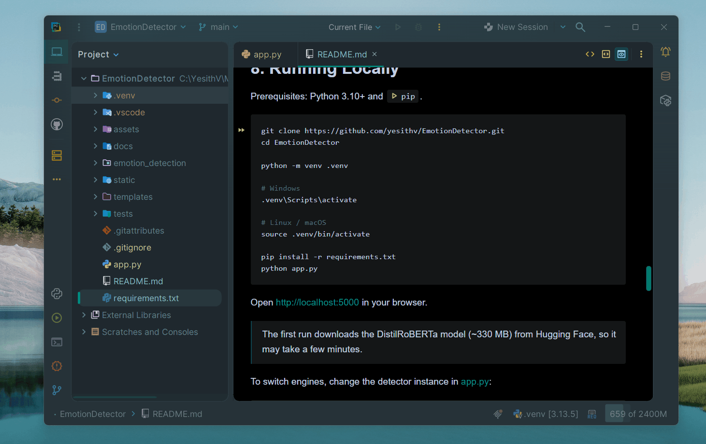
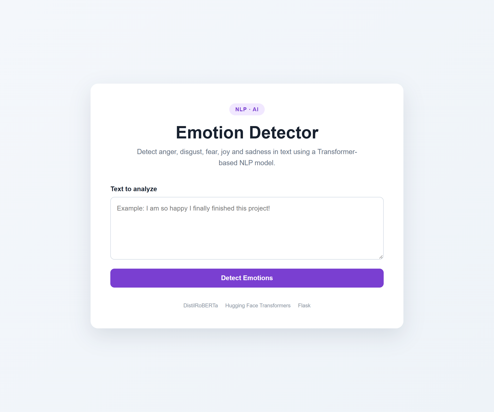
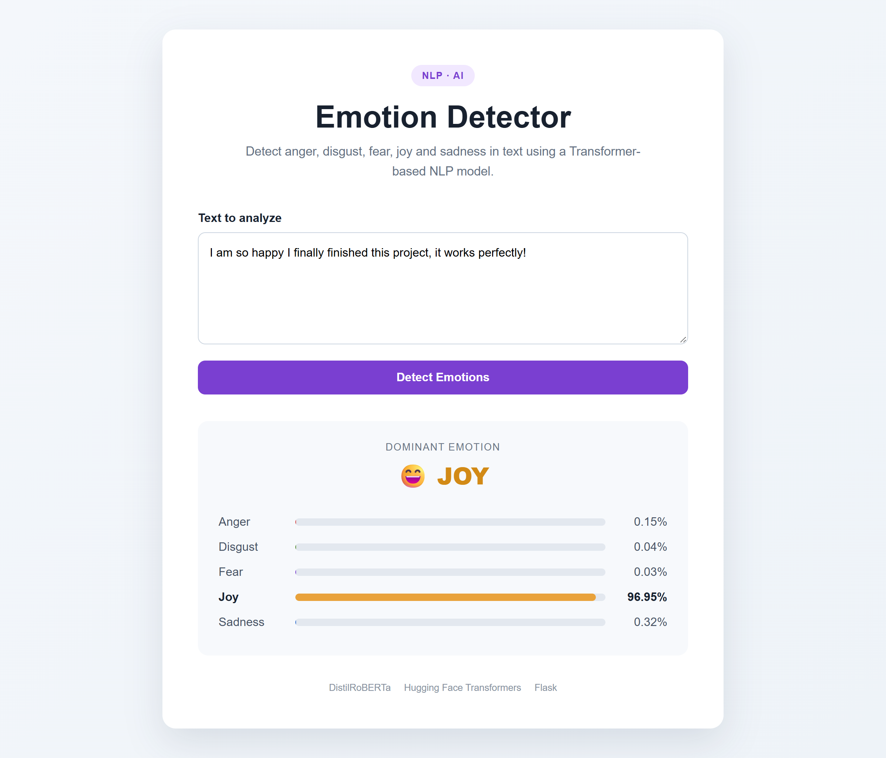
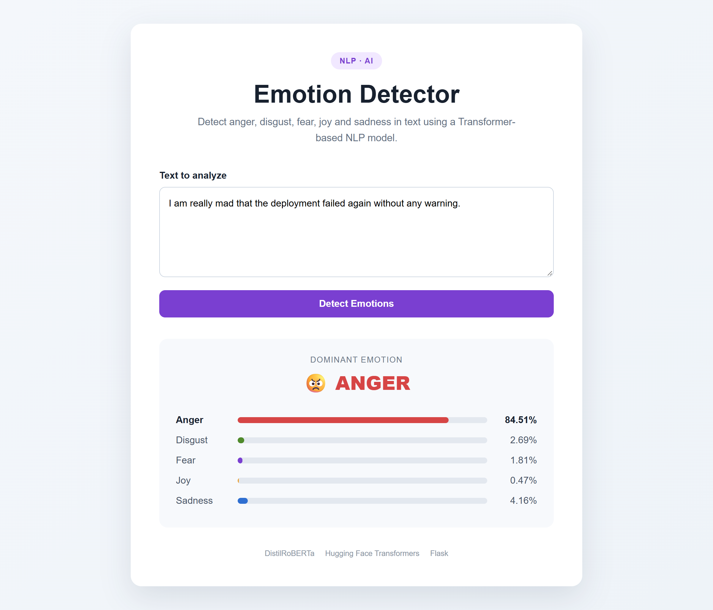
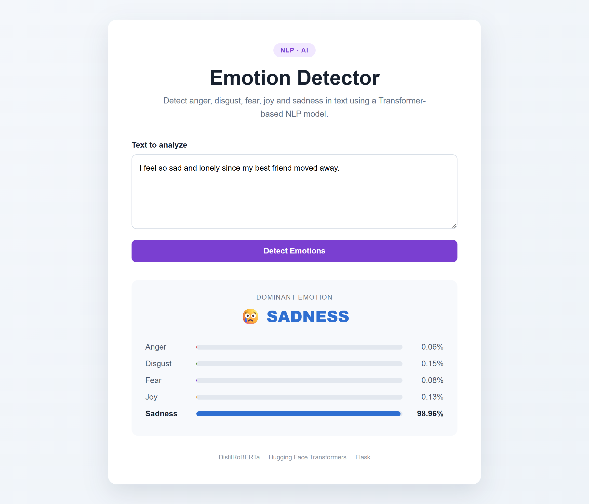
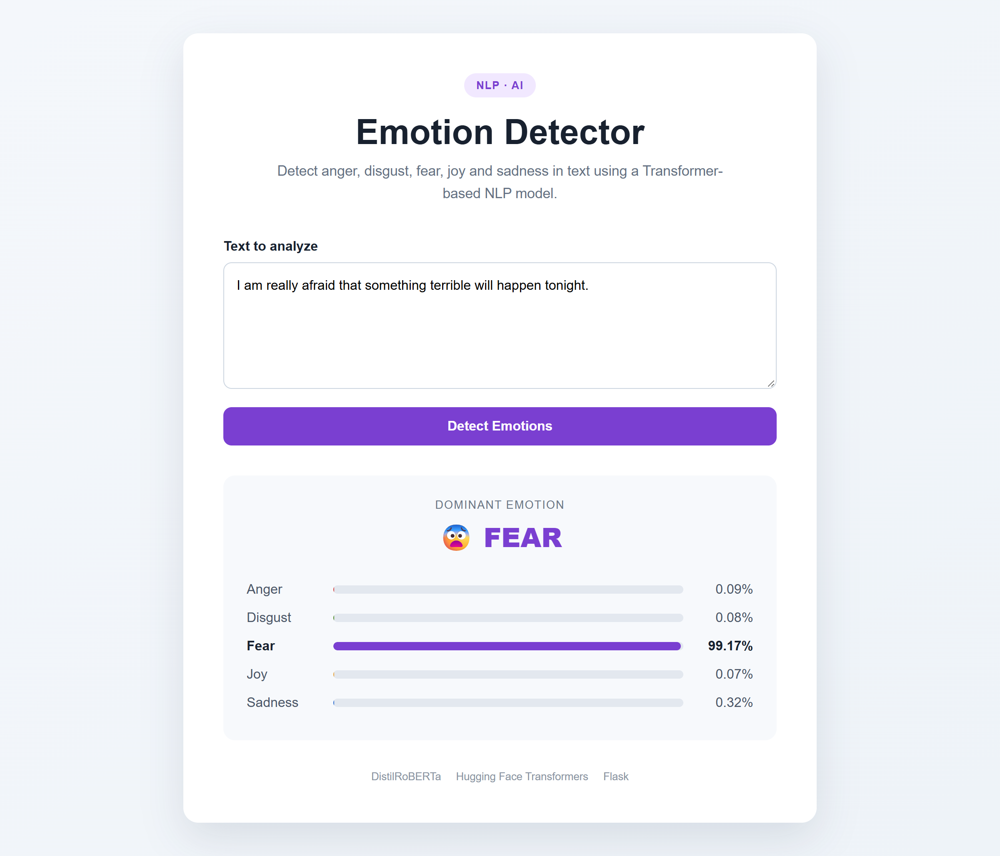
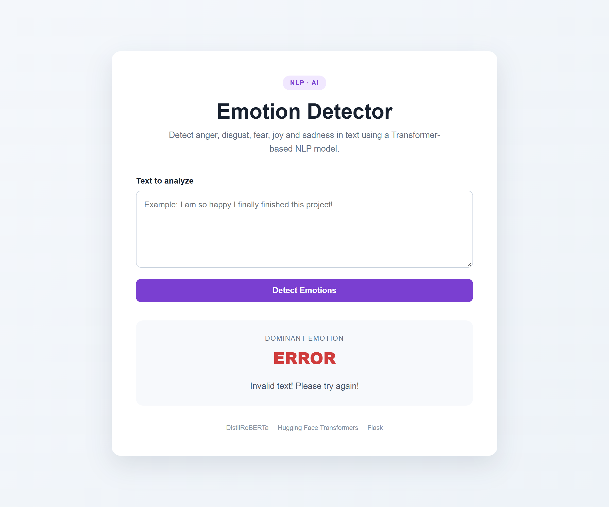
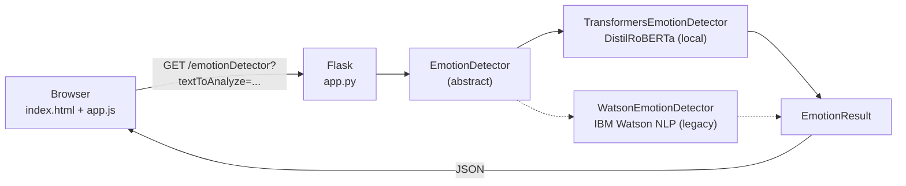

# Emotion Detector

## 1. Overview

A web application built with Python and Flask that detects the emotions expressed in a
piece of text (**anger**, **disgust**, **fear**, **joy** and **sadness**) and highlights the
dominant one, using an embedded Transformer model.

The project started as the final project of the **Developing AI Applications with Python
and Flask** course (IBM), which relied on a hosted IBM Watson NLP service. It was later refactored to run
fully locally with a Hugging Face model behind a common interface, so the engine can be
swapped without touching the web layer.

## 2. Features

- Clean web UI to enter text and view the score of each emotion as a bar chart, with the
  dominant emotion highlighted.
- JSON REST endpoint (`/emotionDetector`) that other clients can consume.
- Pluggable detectors through an abstract `EmotionDetector` interface.
- Two implementations: DistilRoBERTa (default, local) and IBM Watson (legacy).
- Input validation with clear error messages on both the client and the server.
- Unit tests for the local detector.

## 3. Demo



| Home | Joy |
|------|-----|
|  |  |

| Anger | Sadness |
|-------|---------|
|  |  |

| Fear | Error handling |
|------|----------------|
|  |  |

## 4. Architecture

The app follows a simple layered design. The Flask layer depends only on the
`EmotionDetector` abstraction, and every concrete engine returns the same immutable
`EmotionResult` (`anger`, `disgust`, `fear`, `joy`, `sadness`, `dominant_emotion`).



Request flow:

1. The user types text and clicks **Detect Emotions**.
2. `app.js` sends `GET /emotionDetector?textToAnalyze=...`.
3. `app.py` validates the input and calls `detector.detect(text)`.
4. The selected engine returns an `EmotionResult`, serialized as JSON.
5. The UI shows the dominant emotion and a bar per emotion with its percentage.

## 5. Tech Stack

| Layer | Technology |
|-------|------------|
| Backend | Python, Flask |
| NLP / ML | Hugging Face Transformers, PyTorch |
| External API (legacy) | IBM Watson NLP via `requests` |
| Frontend | HTML, CSS, vanilla JavaScript (Fetch API) |
| Testing | `unittest` |

## 6. Project Structure

```
emotion-detector-app/
├── app.py                          # Flask server and routes
├── requirements.txt
├── assets/                         # Screenshots used in this README
├── docs/
│   └── course-evidences/           # Original course deliverables (Watson version)
├── emotion_detection/
│   ├── detector.py                 # EmotionDetector abstract base class
│   ├── result.py                   # EmotionResult dataclass
│   └── implementations/
│       ├── transformers_detector.py
│       └── watson_detector.py
├── static/
│   ├── css/styles.css
│   └── js/app.js
├── templates/
│   └── index.html
└── tests/
    └── test_transformers_detector.py
```

## 7. Emotion Detection Approaches

### 7.1 Hugging Face Transformers / DistilRoBERTa

Default engine. Uses the `pipeline("text-classification")` API with the
[j-hartmann/emotion-english-distilroberta-base](https://huggingface.co/j-hartmann/emotion-english-distilroberta-base)
model, a DistilRoBERTa model fine-tuned on six emotion datasets (tweets, Reddit, self-reports
and TV dialogues).

- The model predicts 7 classes (`anger`, `disgust`, `fear`, `joy`, `neutral`, `sadness`,
  `surprise`). The app keeps the 5 emotions defined by the original course contract.
- Score: the probability of each emotion (0–1); the dominant emotion is the highest one.
- The model is downloaded on first run and cached locally; after that it works offline.
- `truststore` is used so the download also works behind corporate proxies that perform
  SSL inspection.

### 7.2 IBM Watson (Legacy)

The original implementation from the course. It sends a `POST` request to the IBM Watson
NLP `EmotionPredict` endpoint using the `emotion_aggregated-workflow_lang_en_stock` model.

> **Note:** this endpoint is only reachable from inside the IBM Skills Network lab
> environment, so it will not work locally. It is kept for reference and to show how the
> abstraction supports remote engines.

## 8. Running Locally

Prerequisites: Python 3.10+ and `pip`.

```bash
git clone https://github.com/yesithv/emotion-detector-app.git
cd emotion-detector-app

python -m venv .venv

# Windows
.venv\Scripts\activate

# Linux / macOS
source .venv/bin/activate

pip install -r requirements.txt
python app.py
```

Open [http://localhost:5000](http://localhost:5000) in your browser.

> The first run downloads the DistilRoBERTa model (~330 MB) from Hugging Face, so it may
> take a few minutes.

To switch engines, import the desired implementation and change the detector instance in
[app.py](app.py):

```python
from emotion_detection.implementations.watson_detector import WatsonEmotionDetector

detector: EmotionDetector = WatsonEmotionDetector()
```

To add a new engine, create a class that inherits from `EmotionDetector` and implements
`detect(text: str) -> EmotionResult`.

## 9. Running Tests

```bash
python -m unittest discover tests
```

The tests load the real model, so the first run requires internet access.

## 10. API

### `GET /emotionDetector`

| Parameter | Type | Required | Description |
|-----------|------|----------|-------------|
| `textToAnalyze` | string | Yes | Text to analyze |

Success (`200 OK`):

```json
{
  "anger": 0.0012,
  "disgust": 0.0006,
  "fear": 0.0004,
  "joy": 0.9885,
  "sadness": 0.0027,
  "dominant_emotion": "joy"
}
```

Error (`400 Bad Request`) when the text is empty:

```json
{
  "error": "Invalid text! Please try again!"
}
```

Example:

```bash
curl "http://localhost:5000/emotionDetector?textToAnalyze=I%20love%20this%20new%20technology"
```

## 11. Model Comparison

| | DistilRoBERTa (local) | IBM Watson (legacy) |
|---|---|---|
| Approach | Fine-tuned transformer | Hosted emotion workflow |
| Emotions | 7 (5 exposed) | 5 |
| Score meaning | Class probability | Service confidence |
| Speed | Fast on CPU after load | Network-dependent |
| Footprint | Large (PyTorch + model) | Small (HTTP client) |
| Runs offline | Yes, after first download | No |
| Availability | Anywhere | IBM Skills Network lab only |

## 12. What I Learned

- Integrating a pre-trained multi-class NLP model into a web app with Hugging Face `pipeline`.
- Replacing a vendor-locked cloud API with a local open-source model while keeping the
  same output contract.
- Applying the Strategy pattern with abstract base classes to decouple the web layer from
  the model.
- Using immutable dataclasses as a consistent contract between components.
- Building and validating a small JSON API with Flask and consuming it with the Fetch API.
- Writing unit tests for ML-backed components.

## 13. Future Improvements

- Expose the `neutral` and `surprise` classes in the API and UI.
- Select the detector through an environment variable instead of editing code.
- Switch the endpoint to `POST` with a JSON body to support longer texts.
- Add Flask route tests and mock the model in unit tests to speed up CI.
- Containerize the app with Docker and deploy it to a cloud service.
- Support multilingual input (e.g., Spanish) with a multilingual emotion model.
